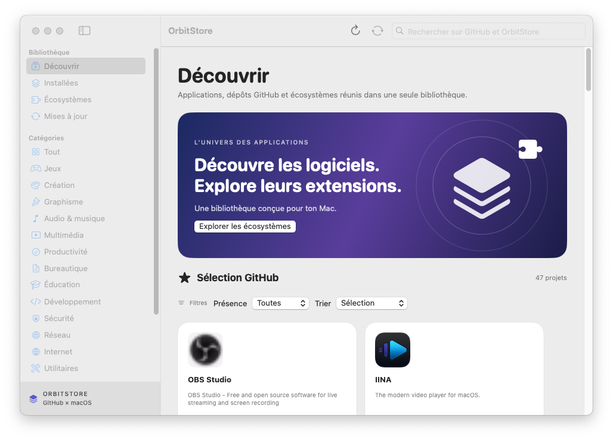
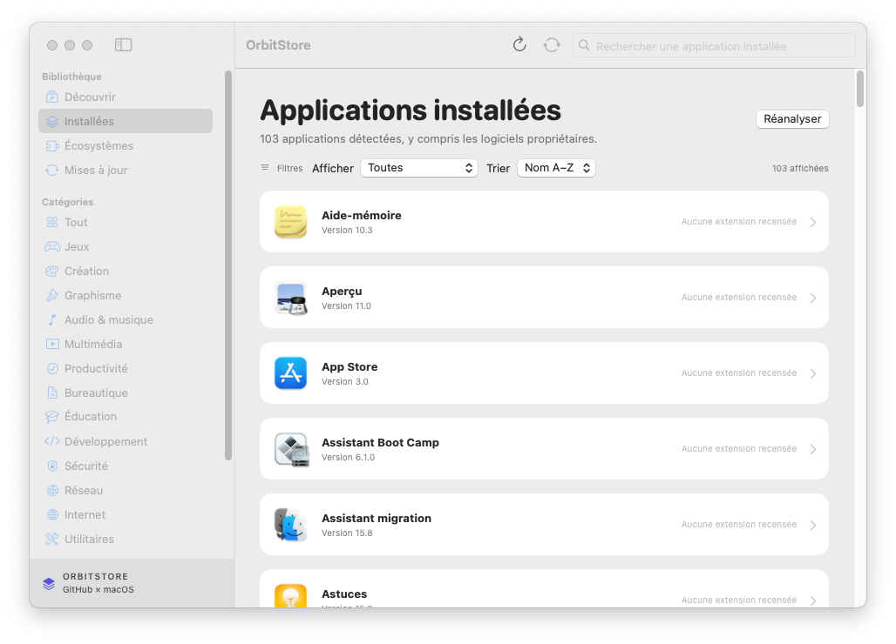
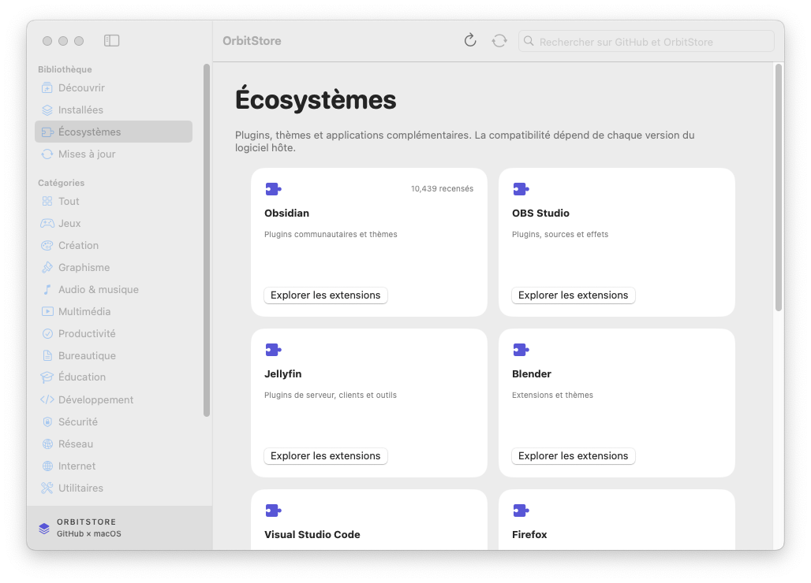
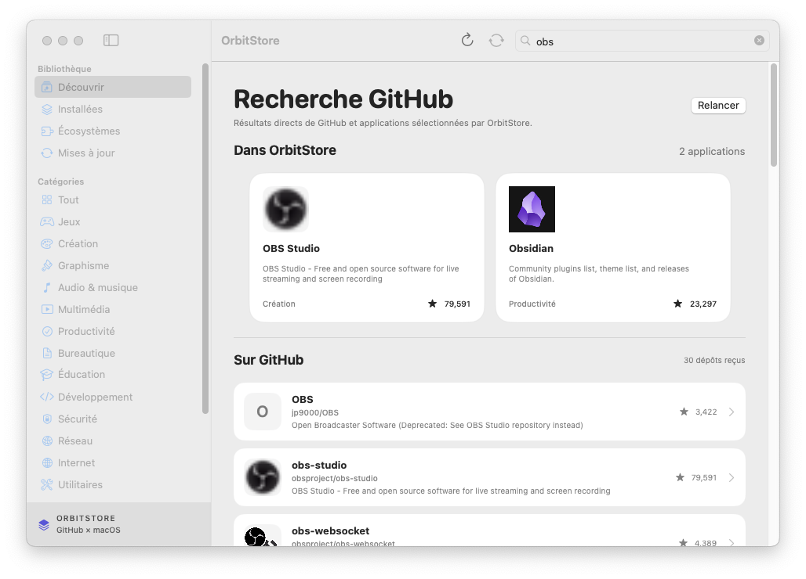

# OrbitStore

**A GitHub-powered app and extension explorer for macOS.**  
**Un explorateur d'applications et d'extensions GitHub pour macOS.**

[English](#english) · [Français](#français) · [Contributing](CONTRIBUTING.md) · [Roadmap](ROADMAP.md) · [Issues](https://github.com/voirfilm-tv/OrbiteStore/issues)

<!-- ORBITSTORE_SCREENSHOTS_START -->
## Screenshots / Captures d'écran

Screenshots captured from earlier running alpha versions (UI may differ from 0.5.0). / Captures authentiques d'anciennes versions alpha (l'interface peut différer de 0.5.0).

### Discover / Découvrir

### Installed / Installées

### Ecosystems / Écosystèmes

### GitHub Search / Recherche GitHub

<!-- ORBITSTORE_SCREENSHOTS_END -->

## English

### About

OrbitStore is an experimental **native SwiftUI application** for macOS 13+. It brings together a curated GitHub software catalog, live repository search, installed-app discovery, extensions and GitHub releases. This is an **early alpha (v0.5.0)**, not yet a complete package manager.

### Implemented in v0.5.0

- Native catalog: Discover, Installed, Ecosystems, Updates and expanded categories, including **Games**.
- Live GitHub repository search and GitHub star counts (**popularity, not user reviews or a security rating**).
- Installed-app inventory for common macOS Applications directories, including proprietary apps; periodic rescan while the app runs.
- In-app extension browsing: Obsidian and Jellyfin registry data, plus GitHub-based results for OBS and other ecosystems. **Compatibility is not guaranteed.**
- Real app icons for locally installed applications; best-effort repository or official-website imagery, neutral fallback otherwise.
- GitHub release checks for known apps and optional package **download**; SHA-256 is checked when GitHub supplies a digest.
- Optional extension discovery notifications for newly detected applications.

### New in 0.5.0 alpha — A friendlier Mac store

- **New Discover design:** richer, more welcoming native SwiftUI hero, visible category shortcuts, horizontal editor picks, and denser cards with real repository icons whenever found.
- **Alternatives:** curated Mac packages such as ArtCraft PhotoCraft, VectorCraft, FilmCraft, PdfCraft, Limusic, darktable and other free/independent alternatives. Comparisons are descriptive, not claims of full feature parity. Alpha projects are marked as experimental, and the collection only links directly to Mac apps confirmed in the index.
- **Self-hosted:** Immich, Jellyfin, Paperless-ngx, Home Assistant, Navidrome, Mealie, Actual Budget and more. The public view favors everyday-use services; Developer Mode reveals administrator-focused stacks such as Coolify and Portainer. These are **web/server deployments**, not fake DMG installations.
- **Clear installation feedback:** clicking Installer immediately confirms the queued action, surfaces progress and errors in a persistent bottom activity strip, and keeps an installation status inside the app detail sheet.
- **Automatic DMG fallback:** if a user-initiated silent copy is unavailable (Gatekeeper, unsigned bundle, permissions or ambiguous package), OrbitStore opens the downloaded DMG in Finder when doing so is safe, and explains the remaining steps. It never disables Gatekeeper or silently runs unsigned apps.
- **Dock-safe window management:** macOS screen visible-frame enforcement avoids obscuring the primary window with the Dock or menu bar. Detail sheets have a smaller, scrollable layout.
- **Faster real logos:** persistent on-disk cache, request coalescing, a low concurrency ceiling and a 12-hour negative-lookup TTL reduce repeat README/image downloads.
- **Smarter index:** daily GitHub Actions release scanning uses incremental negative-result caching, rotating deeper search pages, preferred stable packages, real release download counts and an editorial shortlist. One static, locally cached JSON index serves the Mac app; startup update checks are throttled.

**Alpha limits:** no visual screenshot verification of the redesigned interface has been completed on a real user Mac; indexed DMG/ZIP names do not prove app contents, signatures or compatibility. The self-hosted directory discovers projects but does not deploy servers. GitHub-only cataloging cannot supply commercial Steam/Epic games unless they have legitimate distributed Mac release assets.

### New in 0.4.0 alpha — App Store experience and OrbitStore updates

**Public by default.** The storefront contains only consumer-oriented software found in GitHub releases with recognized macOS DMG, PKG or Mac-specific ZIP assets. Technical repositories and source-only projects are hidden, and asset architecture labels are checked against Apple Silicon / Intel.

**Optional Developer Mode.** Enable it in Preferences → Expérience OrbitStore → Mode développeur to reveal development tools, source-only projects, technical categories and full GitHub repository search. Developer Mode never bypasses Gatekeeper.

**OrbitStore self-updates.** Go to Mises à jour or Preferences to check GitHub Releases. The app verifies the SHA-256 digest of a downloaded OrbitStore DMG, then opens it in Finder. As the release is ad-hoc signed but not Apple-notarized, the user must quit OrbitStore and replace the old app manually. It cannot silently self-replace without bypassing macOS protections.

**Stricter catalog indexing.** Other-platform PKG files, debug symbols and terminal-only release artifacts are excluded; consumer/developer audiences are distinguished; multiple macOS asset names per release help choose the right CPU architecture.

The November 15, 2026 generated feed contained 247 macOS release projects: 165 tagged consumer and 82 developer, before the user's Mac architecture filter. Index counts change on future runs.

**Security caveat:** recognizing the filename of a release asset does not prove its contents or software safety. Package inspection and Gatekeeper checks remain essential.

### New in 0.3.1 alpha — real catalog discovery

- **Live, scalable catalog:** a scheduled GitHub Actions pipeline searches for Mac applications and verifies that upstream GitHub releases contain a macOS-specific DMG, PKG or ZIP asset. The compact JSON index is shared with clients, which cache it locally.
- **First index: 146 macOS release projects (November 15, 2026)**, with source metadata and categories. The count grows and changes as daily indexing discovers more projects.
- **Playable Games category**, separated from game engines, game-porting tools, emulators and launchers. Popular entries are ranked by GitHub stars; game metadata is classified more carefully.
- **Better browsing:** 60 cards per page with incremental loading, macOS-asset availability filter, popularity/activity sorting and explicit catalog refresh.
- **Live GitHub search pagination:** 50 results per page plus a Load More button, without mixing raw code repositories into the vetted macOS index.
- **Much lower client API usage:** a small downloaded index replaces dozens of direct API lookups at every app launch.
- [How the catalog works](docs/CATALOG.md) — transparent limits, attribution, performance and safety.

**Release detection is not a security audit.** Even a repository with a named Mac binary may fail signature validation, Gatekeeper, or architectural compatibility. Commercial Steam/Epic/GOG titles without GitHub releases require separate integrations.

### New in 0.3.0 alpha — lifecycle management

OrbitStore now includes a **first safety-gated installer** and a redesigned native product detail page:

- **One-click installation queue** for supported DMG/ZIP archives containing a single .app. Choose /Applications, ~/Applications or a custom user-writable directory. Packages requiring authorization or rejected by Gatekeeper stay manual; .pkg installers are never run silently.
- **OrbitVerify preflight:** read-only DMG extraction, cautious ZIP entry validation, code-signature verification, Gatekeeper assessment and expected bundle ID where known. A GitHub star count is never treated as trust.
- **Install packs:** curated bulk collections and a custom multi-selection queue, with each app checked separately.
- **Managed updates:** opt-in for apps previously installed by OrbitStore and recorded with a signing Team ID and bundle ID. Running apps, changed publishers, unverifiable packages and permission errors stop automatic replacement.
- **Rollback:** OrbitStore preserves a prior app bundle when it safely replaces an app signed by the same Team ID. Rollback does not restore any changed user data.
- **OrbitDoctor:** inspect installed app signatures, Gatekeeper assessment, executable architectures and advertised Sparkle update feed.
- **Uninstall:** with confirmation, move allowed user apps into Trash. Settings, caches and personal data remain intact; leftover paths can be inspected without deletion.
- **Operation history** stored locally, **release notes**, per-version ignore controls, GitHub/Homebrew Cask/Sparkle source references and opt-in limited update notifications.
- **Extension support:** GitHub/official-registry discovery; a first opt-in Obsidian adapter downloads official-registry plugin assets into a user-selected vault after checking manifest ID and minimum app version. JavaScript plugins are NOT audited or enabled automatically. OBS, Jellyfin and other ecosystems remain discovery-only.
- **New editorial detail sheet** with genuine project icon, GitHub metrics, installation state, changelog, sources, related apps, extensions, and unified action buttons.

**This is not a universal fully automatic installer.** Source-only repositories, PKG installers, multiple apps inside one DMG, unsigned/non-Gatekeeper-approved apps, restricted folders and unverified extension formats require manual handling. No paid Apple Developer certificate is used; OrbitStore's own DMG remains ad-hoc signed and unnotarized. An unsigned pre-release such as OrbitStore itself cannot silently self-install through the security-gated engine.

### 0.2.1 · GitHub releases compatibility fix

- A repository detail now checks actual release assets before displaying a macOS download button.
- GitHub pre-releases are supported and explicitly labeled as preview downloads; the `/releases/latest` endpoint omits them.
- Projects without a recognized macOS package show a clear, non-blocking explanation instead of a misleading network error.
- Files named as Windows/Linux packages, source archives or incompatible CPU architectures are excluded from suggested macOS downloads.

### 0.2.2 · Installed app detection, filters and post-download guidance

- **Installed OrbitStore detection:** matches the canonical macOS bundle identifier `fr.orbitstore.mac`, even though the GitHub repository is named `OrbiteStore`. The inventory also checks LaunchServices and running application bundles outside standard Applications folders.
- **Native filters:** category browsing, live GitHub repository results, installed apps, plugin ecosystems, updates, and the extensions browser now support context-specific filtering and sorting.
- **Search navigation:** the Installed, Ecosystems and Updates pages remain accessible while the search field has text, and search filters those pages locally.
- **Download handoff:** a requested DMG download opens its disk image in Finder. After dragging the app into Applications, select **Vérifier l'installation**. No package installer or unknown executable is automatically run.
- **Update checks:** pre-release support for recognized apps; unattended downloads are restricted to bundle identities explicitly verified in code.
- **Safety:** a previously downloaded old version is no longer presented as the current release.

### Current limitations

- Consumer mode uses GitHub release asset filenames, not a full remote binary inspection. An archive could be mislabeled; the installer still inspects it.
- Consumer/developer classification is heuristic and may require community corrections.
- OrbitStore's own non-notarized DMG can be checked and downloaded within OrbitStore, but replacing the running application is manual.

- **Not yet a universal installer/updater:** automatic installation covers only a narrow, Gatekeeper-accepted .app subset, and only when the destination is writable. PKG and unverified binaries require manual steps.
- The DMG distributed here uses **ad-hoc signing, not Apple notarization**, so Gatekeeper may prompt users. Do not disable system protections globally.
- Installation/rollback and extension adapters are alpha features; no end-to-end compatibility certification exists across all macOS versions and CPU architectures.
- The indexer detects GitHub release assets, not all macOS software distributed through vendor stores or Homebrew. GitHub rate limits and source-only repositories can prevent discovery or installation.
- Community plugins can execute arbitrary code in their host app. Obsidian's official registry inclusion does **not** imply security auditing.
- The local history and backup files may consume space; updates never guarantee rollback of application-created user data.

### Download and build

[Download the experimental v0.3.1 DMG](https://github.com/voirfilm-tv/OrbiteStore/releases/tag/v0.5.0)

Build from source on macOS 13+ with the free Xcode Command Line Tools:

~~~bash
git clone https://github.com/voirfilm-tv/OrbiteStore.git
cd OrbiteStore
swift build -c release
bash scripts/build-dmg.sh
~~~

Output: dist/OrbitStore-0.4.0-unsigned.dmg. Do **not** disable Gatekeeper globally.

### Contribute

Start with the [contributing guide](CONTRIBUTING.md), [open tasks](https://github.com/voirfilm-tv/OrbiteStore/issues), [roadmap](ROADMAP.md), [architecture](docs/ARCHITECTURE.md), [privacy](docs/PRIVACY.md), and [security reporting](SECURITY.md). Small, well-scoped Pull Requests are particularly welcome.

### License

[MIT](LICENSE) covers OrbitStore source code. Third-party app names, trademarks, logos, GitHub content and plugins belong to their respective owners. Listing them does not imply endorsement or verified compatibility.

---

## Français

### Présentation

OrbitStore est une **application native SwiftUI pour macOS 13+**, développée en open source. Elle permet de découvrir des projets GitHub, consulter des dépôts en direct, retrouver les logiciels installés sur le Mac et explorer leurs extensions.

**Version actuelle : alpha 0.5.0.** Il ne s'agit pas encore d'un gestionnaire d'installation universel.

**Déjà disponible :** catalogue grand public par défaut, mode développeur facultatif, mise à jour d'OrbitStore avec contrôle SHA-256, catégories dont **Jeux**, recherche GitHub réelle, nombre d'étoiles GitHub (popularité uniquement), inventaire des applications installées y compris propriétaires, consultation interne de catalogues d'extensions, icônes authentiques quand elles sont disponibles, vérification de releases et téléchargement de certains paquets.

**Limites :** les PKG, applications non signées ou refusées par Gatekeeper et dossiers exigeant des privilèges restent manuels. La gestion des plugins hors Obsidian est principalement exploratoire ; la compatibilité exacte doit être vérifiée. Les mises à jour automatiques ne concernent que des applications précédemment gérées avec identité de signature enregistrée. Les DMG d'OrbitStore ne sont pas notarisés par Apple.

Pour compiler sans payer Apple, installez Xcode ou les Command Line Tools et utilisez les commandes ci-dessus.

**Contribuer :** [guide de contribution](CONTRIBUTING.md) · [feuille de route](ROADMAP.md) · [Issues](https://github.com/voirfilm-tv/OrbiteStore/issues) · [confidentialité](docs/PRIVACY.md) · [sécurité](SECURITY.md).

**Licence MIT.** Les logos et marques tiers conservent leurs droits respectifs.
